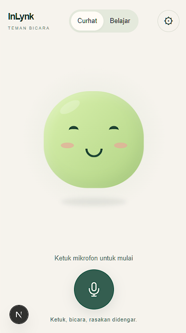

# InLynk

Teman ngobrol berbasis suara untuk curhat dan belajar bahasa. Dibangun sebagai Progressive Web App (PWA) dengan Next.js, TypeScript, dan Tailwind CSS.

## Tampilan

<p align="center">
  
</p>

## Fitur

- **Curhat** — ngobrol santai tanpa teks percakapan di layar, ditemani karakter animasi yang mengikuti emosi dan pemutaran suara. Mendukung campuran Bahasa Indonesia dan Jawa.
- **Belajar bahasa** — latihan percakapan dengan transkrip, koreksi, terjemahan, dan kosakata.
- **Balasan suara bertahap** — streaming respons AI, pemutaran MP3 per kalimat, dan prefetch audio berikutnya untuk mengurangi jeda.
- **Interupsi** — ketuk mikrofon saat AI berbicara untuk menghentikan balasan dan mulai bicara lagi.
- **Pilihan suara** — Gadis untuk Bahasa Indonesia, Siti sebagai alternatif suara Jawa di mode Curhat, serta suara sesuai bahasa target di mode Belajar.
- **Pengaturan** — bahasa belajar, suara balasan, kecepatan bicara, dan hapus percakapan.
- **PWA** — mendukung pemasangan melalui browser, tampilan responsif, serta tema terang dan gelap.

## Cara menjalankan

### 1. Persiapan

- Node.js **20.9 atau lebih baru** dan npm.
- Chrome direkomendasikan untuk pengenalan suara.
- Endpoint AI yang mendukung **OpenAI-compatible chat completions streaming** dan **Edge TTS melalui `/audio/speech`**. Keduanya menggunakan base URL dan API key yang sama.

### 2. Instal dependensi

```sh
npm install --legacy-peer-deps
```

### 3. Atur environment

Salin `.env.example` menjadi `.env.local`:

```sh
cp .env.example .env.local
```

Pada PowerShell:

```powershell
Copy-Item .env.example .env.local
```

Isi `.env.local` sesuai layanan yang digunakan:

```dotenv
LLM_API_KEY=isi-api-key-anda
LLM_BASE_URL=http://localhost:20128/v1
LLM_MODEL=isi-id-model-anda
```

`LLM_BASE_URL` tidak menyertakan `/chat/completions` atau `/audio/speech`. URL di atas merupakan contoh layanan lokal yang harus sudah berjalan, bukan layanan yang disediakan proyek ini. Endpoint remote harus memakai HTTPS.

> API key hanya digunakan di server. Jangan memasukkan `.env.local` atau key asli ke GitHub; biarkan `.env.example` tanpa rahasia.

### 4. Jalankan aplikasi

Terminal pertama — server API pengembangan:

```sh
npm run server
```

Terminal kedua — antarmuka aplikasi:

```sh
npm run dev
```

Buka **http://localhost:3000**, izinkan mikrofon, pilih **Curhat** atau **Belajar**, lalu ketuk tombol mikrofon.

Server API berjalan di `127.0.0.1:3001`. Kedua terminal harus tetap berjalan selama pengembangan. Jika port API diubah melalui `API_PORT`, gunakan nilai yang sama pada kedua proses.

Untuk mencoba tanpa mikrofon, buka **http://localhost:3000/?debug=1**. Input teks pengujian hanya muncul saat parameter tersebut digunakan.

### Menjalankan versi produksi

```sh
npm run build
npm start
```

Produksi menggunakan satu server Next.js; tidak perlu menjalankan `npm run server` secara terpisah. Layanan AI/TTS tetap harus berjalan dan dapat dijangkau dari server aplikasi. `localhost` pada server deployment bukan komputer lokal Anda.

## Pengujian

```sh
npm test
npm run typecheck
```

## Dukungan browser dan privasi

- Target utama: **Chrome desktop dan Android**. Safari iOS memiliki keterbatasan pengenalan suara dan pemutaran audio; Firefox belum mendukung input suara yang digunakan aplikasi ini.
- Akses mikrofon memerlukan **HTTPS** atau `localhost`. Pemasangan PWA dan service worker tersedia pada build produksi; percakapan tetap membutuhkan koneksi internet.
- Riwayat percakapan hanya berada di memori selama sesi. Pengaturan disimpan di perangkat; percakapan tidak disimpan ke database.
- Audio mikrofon diproses oleh layanan pengenalan suara browser. Teks percakapan dikirim ke penyedia AI, sementara teks balasan dikirim ke layanan TTS. Aplikasi tidak merekam atau menyimpan audio secara permanen.
